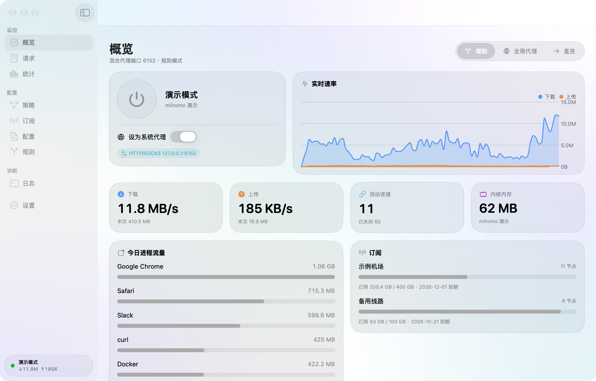
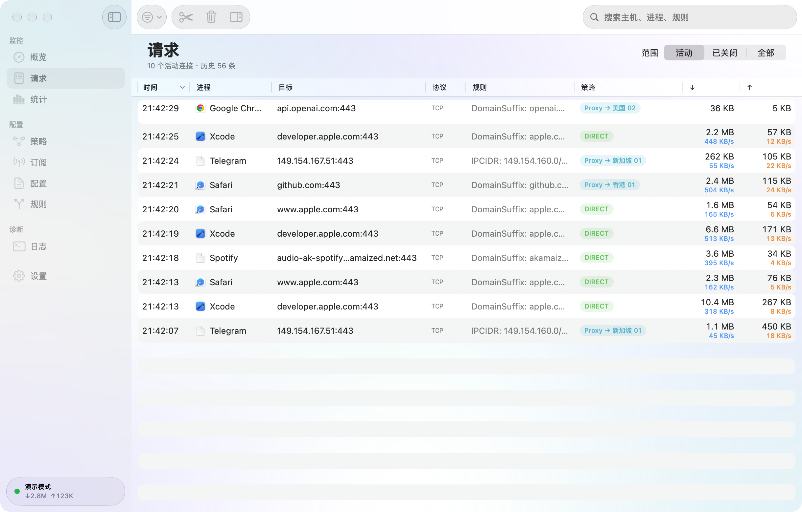
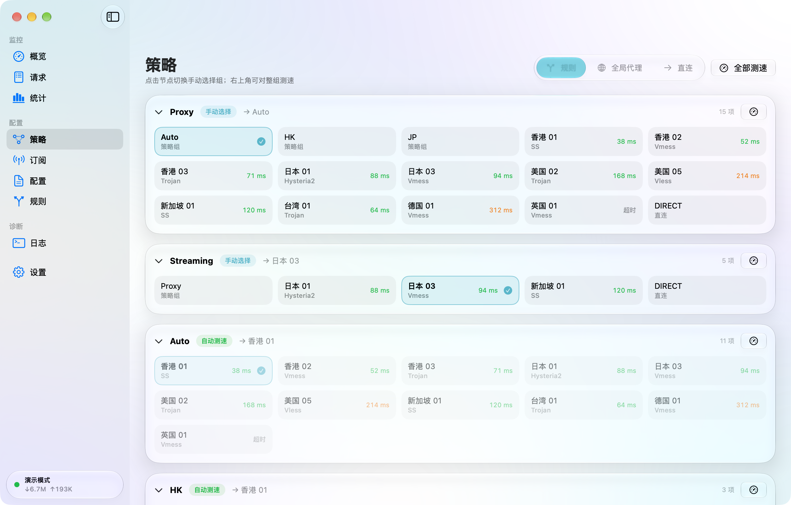
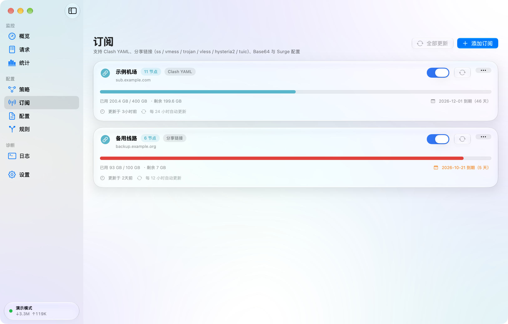
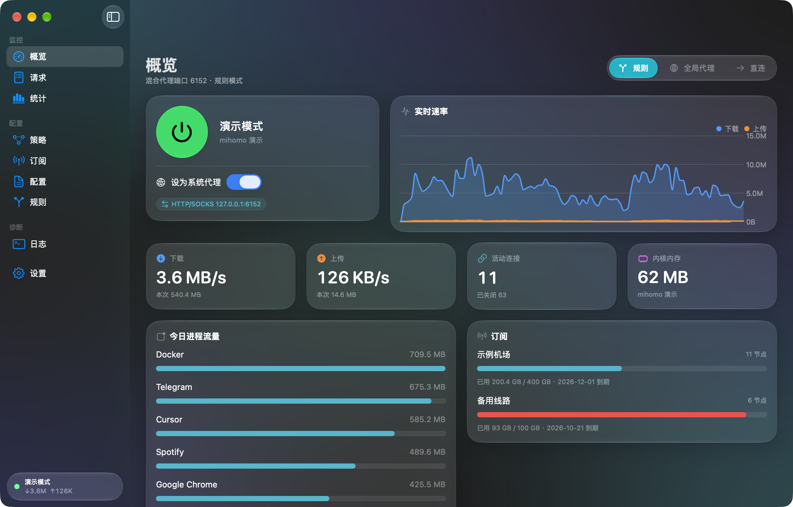

# Flash

macOS 原生的 Surge 风格网络工具：规则分流、策略组、订阅管理、实时请求查看，界面采用 macOS 26 的 **Liquid Glass** 设计语言。

代理内核使用 [mihomo](https://github.com/MetaCubeX/mihomo)（Clash Meta）作为子进程内置，界面、配置、订阅与流量分析由 SwiftUI 完成。



| 请求 | 策略 |
| --- | --- |
|  |  |
|  |  |

## 功能

- **流量接管**：一键启动内核并设为系统代理；同时提供本地混合端口（HTTP + SOCKS5，默认 `6152`）。正常退出、被信号终止时会恢复原有系统代理设置；若遇强制退出，下次启动时自动恢复。
- **Surge 风格配置**：`[General]` `[Proxy]` `[Proxy Group]` `[Rule]` `[Host]` `[Ruleset X]`、`#!include`、`#!MANAGED-CONFIG` 受管配置；支持本地覆盖层（更新受管配置不会丢失自己的规则）。
- **协议**：HTTP / HTTPS / SOCKS5 / Shadowsocks / VMess / Trojan / Hysteria2 / TUIC / Snell / AnyTLS（VLESS 通过订阅导入）。
- **策略组**：手动选择、自动测速、故障转移、负载均衡；支持 `policy-regex-filter`、`include-all-proxies`，按地区自动分组。
- **订阅**：Clash YAML、分享链接（ss / vmess / trojan / vless / hysteria2 / tuic）、Base64、Surge 配置；自动更新、ETag、流量用量与到期时间。
- **请求查看**：来自内核的实时连接表（进程、目标、规则、策略链、上下行速率）、详情检查器、已关闭历史、右键一键添加规则、断开连接。
- **统计**：按进程 / 域名 / 策略聚合的每日流量（SQLite）。
- **规则测试**：输入域名 / IP / 端口 / 进程，本地模拟命中的规则。
- **菜单栏**：实时速率、模式切换、策略快速切换。
- **辅助功能**：遵循“降低透明度”，玻璃材质自动退化为不透明卡片；深色 / 浅色模式。

## 范围

当前版本通过**系统代理 + 本地端口**接管流量，无需付费开发者账号。以下能力属于后续阶段，当前未实现：MitM / HTTPS 解密、URL 重写、脚本、Network Extension（增强模式 / TUN）、模块、命令行工具。请求页展示的是**连接级**信息（来自 mihomo `/connections`），不是 HTTP 报文级别。

## 构建与运行

要求：macOS 26+、Xcode 26+、[XcodeGen](https://github.com/yonaskolb/XcodeGen)。

```bash
brew install xcodegen
scripts/fetch-core.sh        # 下载 mihomo 内核与 geo 数据（构建时也会自动执行）
xcodegen generate
open Flash.xcodeproj         # 或：scripts/build.sh 直接产出 dist/Flash.app 与 .dmg
```

### 打包

```bash
scripts/build.sh             # 生成 dist/Flash.app 与 dist/Flash-<版本>.dmg（ad-hoc 签名）
scripts/build.sh --no-dmg    # 只生成 .app
```

未经过公证，首次打开请在 Finder 中右键 → 打开。

### 测试与验收

```bash
cd Packages/FlashKit && swift test     # 单元测试 + 真实内核集成测试
scripts/smoke-test.sh                  # 内核冒烟测试
scripts/live-check.sh                  # 启动真实应用，检查连接捕获与进程识别（不改系统代理）
scripts/shot.sh dashboard              # 以演示模式启动并截图（FLASH_DARK=1 为深色）
```

演示模式：`Flash.app/Contents/MacOS/Flash --demo`，使用独立临时目录与模拟数据，不会触碰真实配置与系统代理。

## 架构

```
Flash/                     SwiftUI 应用（界面、AppModel、菜单栏）
Packages/FlashKit/         核心库
  Profile/                 Surge 配置解析 → 合成 → mihomo YAML 生成
  Subscription/            订阅下载、解码、更新
  Controller/              mihomo REST / WebSocket 客户端
  Core/                    内核进程管理（由 launchd 托管）
  System/                  系统代理（networksetup）备份、设置、恢复
  Traffic/                 连接差分引擎与每日流量统计
scripts/                   构建、打包、验收脚本
```

要点：

- 内核通过 `launchctl bootstrap` 以 launchd 任务运行。实测作为 App 的直接子进程时，macOS 会让内核读不到其他进程的套接字归属（进程识别失效）；另外**不要对内核二进制重新签名**，重签同样会使进程识别失效。
- 配置变更先用 `mihomo -t` 校验，通过后再热重载；校验失败保留当前运行配置。
- 系统代理设置前会备份并写入“脏标记”，下次启动若发现上次异常退出会先恢复。

## 许可

Flash 以 [GPL-3.0](LICENSE) 发布。内置的 mihomo 同为 GPL-3.0，其源码见 <https://github.com/MetaCubeX/mihomo>。
